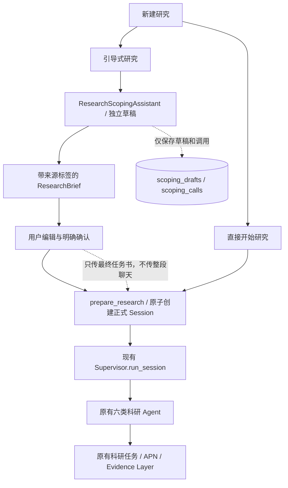

# 双模式研究入口与 Research Scoping Assistant

实现日期：2026-10-26。此功能在现有 Supervisor 之前工作，不是第七个科研 Agent；原有六类 Agent、APN、Evidence Layer、科研 task 队列保持原职责。

## 如何体验

不安装依赖、不使用 API Key 的离线预览：

```bash
cd Co-Scientist
.venv/bin/python scripts/scoping_preview.py --port 7883
```

打开 `http://127.0.0.1:7883/#new`。脚本创建全新临时 SQLite 库，并打印位置。它不加载/迁移真实科研数据库，也不启动 Supervisor。页面顶部有提示；确认任务书会创建一条暂停的 Session，方便检查交接结果，**不会运行科研 Agent、收费模型或蛋白质计算**。停止预览后仍可在打印的临时目录检查数据，系统临时目录将来可能被清理。

常规服务在迁移后使用同一网页：点击“新建研究”选择入口。

- **从一个想法开始**：输入一句初步想法，与助手交流；可跳过问题、重新生成或随时生成任务书。任务书允许编辑各栏目与信息来源、增删条目、保存或返回讨论。切换入口时会先保存当前任务书；刷新带 `#guided/<draft_id>` 的地址会恢复。也可从引导页的历史讨论继续。
- **我已有明确的研究目标**：在原有输入区提交问题，沿用预算/时限确认框，直接进入科研流程，不必回答引导问题。同一页面内切换入口会保留直接输入区的文字；尚未提交的直接输入不承诺跨刷新保存。

离线 Mock 提供按主题、方法/数据回答及跳过情形变化的确定性示范，不代表真实科研顾问的能力。真实模型需要下述手动配置。

## 真实模型的手动开关

新增配置示例为 `config/scoping.example.toml`。默认：

```toml
[scoping]
allow_live_calls = false
# model = "与现有 provider 匹配的模型 ID"
max_calls = 24
max_turns = 20
max_tokens = 60000
budget_usd = 1.0
timeout_seconds = 60
context_chars = 16000
output_tokens = 2400
```

需要人工在自己的配置 overlay 中设置 `allow_live_calls=true` 并重启服务；网页自动使用服务端选定的 Provider，不再提供“使用模型 API”复选框。未指定 model 时复用 `models.parse_goal`，Provider/DeepSeek base URL 和 Key 继续从已有服务端配置读取。不要把 Key 放入 HTML、JavaScript 或这个示例文件。

引导只支持现有 API Providers；`claude_cli`、`codex_cli` 等会自行运行工具的 CLI 后端被拒绝，不会因为引导对话启动自主工具。每次引导只有一个无工具的模型调用，没有检索、APN 或代码执行权限。

费用是项目现有价格表的估算，不是服务商账单。引导预算独立于正式研究预算；开启引导 API 不会自动开始正式研究。常规服务中，用户最后确认“开始研究”仍会按原工作流调用正式科研模型和工具。

## 数据流与原有系统的衔接



`web/research_start.py::prepare_research()` 是两个入口共用的 Session 创建函数。直接入口保留原 `_parse_goal()`；引导入口已经有用户确认的结构化任务书，Supervisor 直接使用该计划，避免再次让 LLM 改写/丢掉来源标签。`Supervisor.run_session(prepared_session_id=...)` 原子领取暂停的准备会话，再按原逻辑建立初始 Generation tasks，随后进入现有主循环；同一个准备会话不能重复启动。

现有上下文主要通过 `Session.research_plan`、假设/review artifact 和 feedback 表组合进入 Agent Prompt。引导模块不另建科研 Context Memory：最终核心问题进入 `research_goal` / `ResearchPlan.objective`，完整的**最终任务书**以来源标签进入 `ResearchPlan.preferences`，约束另入 `ResearchPlan.constraints`。确认快照、draft ID 与启动配置保存在 Session 的 `web_launch` 元数据；原始聊天只留在引导草稿中。直接入口的偏好仍进入原有 human feedback。

HTTP 提交现在可以直接返回准确的 `session_id`，前端不再靠“列表中第一个新 Session”猜测创建结果。

## Research Brief 结构与科学信息来源

`models/scoping.py::ResearchBrief` 包含：

```json
{
  "topic": "研究主题提案",
  "core_question": "核心问题提案",
  "background": [],
  "objectives": [],
  "known_facts": [
    {"text": "用户逐字描述的信息", "source": "user_confirmed", "message_ids": ["用户消息ID"]}
  ],
  "directions": [
    {"text": "一种可考虑的方向", "source": "ai_suggestion", "message_ids": []}
  ],
  "constraints": [],
  "open_questions": [],
  "tasks": []
}
```

所有列表使用同一个 `BriefClaim` 类型，`source` 只有三个值：`user_confirmed` / `ai_suggestion` / `unconfirmed`。用户已确认表示用户自述，不表示文献或实验核验。

- 生成时，`enforce_user_sources()` 验证 source。没有有效用户 message ID 或不是用户原文片段的“已确认”内容会降为 `unconfirmed`。这是一项保守约束，会把某些合理改写也降级，留给用户处理。
- 编辑时用户可以明确调整来源；最终确认不自动把所有 AI 建议升级为事实。
- `research_input()` 保留来源标签，并说明确认采用任务书不等于假设已被证实。
- 主题、核心问题不能为空，正文总长度不超过 20000 字；每个栏目、条目和消息另有限制。

生成、保存、刷新草稿均不会创建正式 Session。只有 `/confirm` 的明确确认才将草稿与新 Session 在同一事务中关联；重复确认返回原 Session。已确认草稿不能继续覆盖，后续应开启新讨论或使用原有科研反馈机制。

## 自定义上限与附件（2026-10-26 更新）

两种入口均可编辑预算、Token 与运行时限。引导页点击“参数”可保存讨论专属上限；直接研究输入区的“参数”与启动确认框使用同一组设置，关闭后再打开保留。预算是停止用的估算上限，实际用量仍按记录显示。引导时限累计模型调用耗时，不累计用户思考/离线时间；单次调用还受服务端 timeout 限制。正式研究沿用原 Supervisor 的运行截止时间。

两个输入区的“＋”均可多选文件，也提供拖放和粘贴文件的处理。支持 PDF、DOCX、TXT、MD、CSV、JSON、PNG、JPG/JPEG、WebP。默认每文件 10 MiB、每组存储 30 MiB、最多 8 个有效附件，multipart 请求在解析前有总大小限制。

文档在本机提取文字，并限制为最多 30 个 PDF 页面、24000 字符；进入单次上下文时再次截断并标记。加密/扫描 PDF 无文字时显示“未提取文字”，不执行 OCR。DOCX 只解析正文 XML，不解压到文件系统、不运行宏。原始文件与 SHA-256 保留，使用随机文件 ID 存储，文件名不会作为文件路径。

图片可预览。`[uploads] vision_enabled=false` 时只保存和展示，不声称模型看过图。只有维护者确认配置的 API 模型支持视觉，并启用该项后，才通过 OpenAI-compatible/Anthropic 的标准图片输入发送，每次最多 4 张；上下文标注实际发送了哪些附件。实际模型视觉质量尚未验证。Mock 不会进行科研分析或图像理解。

附件作为 `user_material_unverified` 引用，不自动进入 Scientific Evidence Layer。正式确认时，将附件组锁定到 Session，并把有界文档文字与来源放入 ResearchPlan；图片在直接研究的 parse_goal 阶段可按配置发送。引导阶段的图片解释必须经任务书审阅，不会把整段聊天自动交给六 Agent。研究文件区可以重新下载附件。附件移除为归档，已确认任务不能改换原始材料。

迁移 `0012_user_inputs.sql` 新增 input_groups/input_files、引导参数与运行耗时字段。本轮仅迁移隔离测试/预览库。新增 27 个附件/预算测试实例，完整回归为 499 项通过；实际记录见 本轮验证（本机运行记录，未随源码公开）。

## 持久化、上下文与错误处理

迁移 `0011_research_scoping.sql` 新增两张独立表：

| 表 | 保存内容 |
|---|---|
| `scoping_drafts` | 独立聊天、任务书、乐观版本号、是否采用真实模型、当前调用 lease、正式 Session 关联 |
| `scoping_calls` | request ID、操作、模型、完整 Prompt 与 SHA-256、结果、状态/错误、input/output tokens、估算成本、未知开销预留、Provider transcript 元数据 |

API Providers 复用原有请求/响应、路由、计价与 transcript artifact 写入逻辑；`llm/accounting.py::persist_call()` 将 `research_scoping` 的账目放到引导表，而不是强行创建科研 Session 或伪造 task。六 Agent 的账目仍写原来的 transcripts 和 sessions。

每个草稿通过数据库事务领取调用，拒绝同草稿并发写入和过期版本。request ID 防止同一成功请求重放。消息在 LLM 前保存；输出异常不会丢掉用户输入。超时、服务错误、JSON 格式错误或截断输出会留下失败记录，用户可以重新生成，系统不自动追加一串收费“修复调用”。完成回复时再次递增版本，防止调用期间的旧快照覆盖新任务书。

聊天保留完整历史供刷新；**模型上下文**只选择首条想法、最近消息和能容纳的完整任务书，明确标注截断/省略。不会将半截 JSON 当成摘要，也不会由未经确认的自动摘要产生“事实”。这仍可能遗漏很早的讨论，用户应把重要条件保存进任务书；不是无限记忆。

每次调用在开始前检查调用数、用户轮数、token 和 USD 预算。模型响应有输出 token 上限和 schema 长度限制。失败/服务重启导致远端用量未知时保留预留，不能把未知费用当成免费；实际响应元数据到达后覆盖预留。价格估算与供应商计费存在差异，网络重试也不能保证严格逐美元停费。

## API 简表

| 请求 | 作用 |
|---|---|
| `GET /api/scoping` | 讨论历史、可用模式与限额 |
| `POST /api/scoping` `{use_live:false}` | 新引导草稿 |
| `GET /api/scoping/{id}` | 恢复聊天、任务书与调用状态 |
| `POST /api/scoping/{id}/turns` | `{operation:message/regenerate/brief,text,request_id,version}` |
| `PUT /api/scoping/{id}/brief` | `{brief,version}` 保存用户编辑，不启动研究 |
| `POST /api/scoping/{id}/confirm` | `{brief,version,confirmed:true,options}` 原子确认与创建 Session |
| `POST /sessions/new` | 原直接研究入口；`Accept: application/json` 返回准确 Session ID，普通表单仍重定向 |

两种创建都复用 `LaunchOptions`（预算、初始假设数、时限、研究模式和分子范围）。400/422/409/429/502 等错误在前端给出提示；JSON/模型原始异常和 API Key 不发送到页面。

## 数据库升级与常规启动

本轮仅升级测试/预览数据库，未改真实科研数据库。升级现有服务前先停止活动 worker、正确备份 SQLite/WAL，再在**原有配置**下运行现有 `co-scientist init`，随后重启 serve。迁移只新增表和索引，不改已有 hypothesis、evidence 或 task 数据。

示例（由维护者确认选中的配置/数据目录）：

```bash
.venv/bin/co-scientist --config /path/to/your-existing-config.toml init
.venv/bin/co-scientist --config /path/to/your-existing-config.toml serve --host 127.0.0.1 --port 7879
```

不要同时启动多个进程操作同一正在迁移的真实数据库。若只想看界面，直接使用上面的 `scripts/scoping_preview.py`。

## 验证与仍需验证的部分

详细命令、失败修复、实际浏览器 Session ID 和范围见 验证记录（本机运行记录，未随源码公开），实际浏览器测试数据见 JSON 快照（本机运行记录，未随源码公开）。新增 21 个测试实例，完整回归 **472 passed**，原有 APN、Evidence Layer、队列及六 Agent 测试均通过。

尚未进行真实 LLM 联调：自然语言引导质量、不同 provider 的 JSON 稳定性、建议质量、长上下文取舍和实际计费均需授权后用小预算人工评估。Mock 不能证明科研指导有效。当前不是多用户安全产品；草稿按 ID 隔离，但没有新增用户身份/所有权 ACL，沿用本机服务边界，不能直接面向公网课题组部署。

若进程恰在正式 Session 创建后、Supervisor bootstrap 前退出，会留下暂停的准备 Session；当前不提供自动跨进程重启运行协调。不要把普通 resume（针对已有科研 task）当成这段 bootstrap 的完整恢复协议；需要维护者检查再处理。这不影响已测试的正常创建与同进程重复启动保护。

## 本轮文件清单

| 新增/修改 | 文件 | 作用 |
|---|---|---|
| 新增 | `co_scientist/scoping.py` | ResearchScopingAssistant、System Prompt、独立预算、Mock Provider、上下文与调用恢复 |
| 新增 | `co_scientist/models/scoping.py` | BriefClaim、ResearchBrief、来源校验和正式研究输入转换 |
| 新增 | `co_scientist/storage/repos/scoping.py` | 引导草稿和调用持久化/用量读取 |
| 新增 | `co_scientist/storage/migrations/0011_research_scoping.sql` | 兼容旧库的独立表迁移 |
| 新增 | `co_scientist/llm/accounting.py` | 引导/科研两类 Provider 账目分流 |
| 新增 | `co_scientist/web/scoping.py` | 引导 API、编辑/版本冲突和原子确认 |
| 新增 | `co_scientist/web/research_start.py` | 两种入口共用的 Session 准备与后台启动 |
| 新增 | `co_scientist/web/static/scoping.js` | 聊天、任务书编辑、恢复、重试与预览交互 |
| 新增 | `co_scientist/tests/unit/test_research_scoping.py` | 21 个 API、并发、异常、迁移、Provider 和 Supervisor 交接测试 |
| 新增 | `scripts/scoping_preview.py`、`config/scoping.example.toml` | 隔离预览与手动配置样例 |
| 修改 | `co_scientist/config.py` | 加入默认关闭真实调用的 ScopingCfg |
| 修改 | `co_scientist/llm/{openai_client,anthropic_client}.py` | 复用 Provider，调用共同账目持久化函数 |
| 修改 | `co_scientist/storage/repos/sessions.py` | 支持调用方事务内插入，不破坏默认提交行为 |
| 修改 | `co_scientist/storage/schema.sql` | 同步规范 schema |
| 修改 | `co_scientist/agents/supervisor.py` | 可领取已确认/已准备 Session，复用原有初始任务与主循环 |
| 修改 | `co_scientist/web/{app,studio}.py` | 注册引导 API、共用直接入口创建、离线预览标记 |
| 修改 | `co_scientist/web/templates/studio.html`、`static/studio.{js,css}` | 双入口、共享确认框、原页面视觉及轻量样式 |
| 新增 | 本说明与 `docs/validation/research_scoping*` | 使用、验证与实际记录 |
